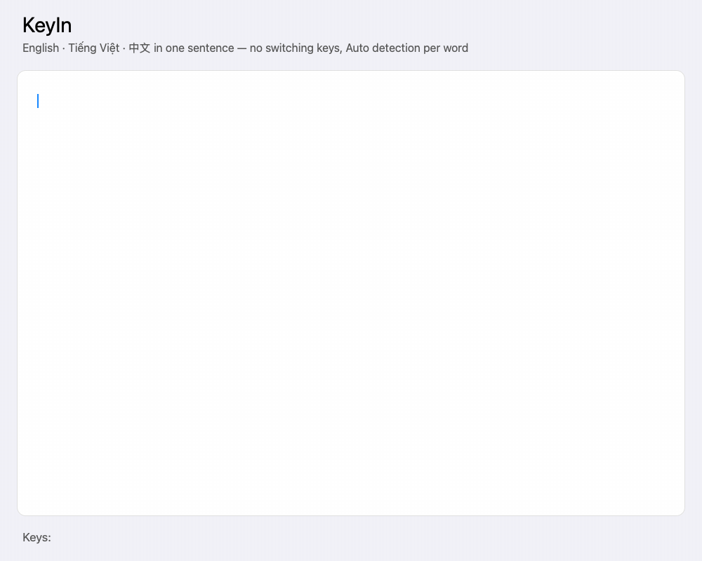

# KeyIn

**A local-first macOS keyboard for English, Vietnamese Telex, and Simplified Chinese.**



The animation records real KeyIn controller and Rime output, one keystroke at a
time, in a demonstration layout (not a TextEdit screen recording). It shows
English, Vietnamese Telex, Chinese Pinyin, and contextual initials.
Reproduce it after building with `./scripts/record-demo.sh` (requires FFmpeg).

**Status:** experimental 0.3 source release · **License:** LGPL-3.0-or-later

## Overview

A native macOS input method with a Rust Telex/detection engine, a stateful librime
Chinese engine, and an Objective-C InputMethodKit adapter. All processing stays
on-device. No network service or telemetry. Chinese candidate selections may be
stored in a local user dictionary when learning is enabled.

This is an experimental source release, not a production-readiness claim. The current
Homebrew-based ARM64 build requires macOS 27 because of its bundled dependencies.
The build derives the minimum OS version from the packaged Mach-O files; older
macOS support requires rebuilding all dependencies for that deployment target.

## Build and verification

Requires Rust/Cargo, Xcode Command Line Tools, Homebrew, and `brew install librime`.

```sh
cargo test
cargo clippy --all-targets -- -D warnings
./scripts/build.sh
./scripts/test-native.sh
./scripts/install.sh
```

The build precompiles Rime schemas and dictionary data, copies librime and its
non-system dependency graph into `Contents/Frameworks`, rewrites load paths, and
signs nested libraries and the app ad hoc. Runtime does not require Homebrew.
Dependency licenses and exact Homebrew receipts are bundled in `Resources/ThirdParty`.
Installation registers `~/Library/Input Methods/KeyIn.app`. The install script
still refuses to overwrite an existing app; back up the old app and switch to ABC
before replacing it. Select KeyIn from the input menu afterward.

## Typing

- **English:** words compose inline. Common words are protected from Telex.
- **Vietnamese:** Telex `aa â`, `aw ă`, `ee ê`, `oo ô`, `ow ơ`, `uw ư`, `w ư`,
  `dd đ`, tones `s f r x j`, and `z` removes a tone. `nhwng` → `nhưng`,
  `tieengs` → `tiếng`. Repeated shortcut `ww` escapes to `w`.
- **Chinese:** Rime Simplified Pinyin, with sentence composition, completion,
  initial abbreviations in manual Chinese mode or after Chinese input in Auto, and optional local learning.
  `kankan` → `看看`, `zenmeyang` → `怎么样`, `nihaolema` → `你好了吗`,
  `woganjuehenhaole` → `我感觉很好了`. Rime renders syllable separators itself.
  Typed apostrophes can explicitly disambiguate `xi'an` from `xian`.
- **Space / Return / 1–9:** select a candidate. Selecting a shorter segment keeps
  the remaining phrase in composition, so it can be selected separately.
- **Left / Right:** candidate pages, showing up to 90 candidates in groups of 9.
  **Shift–Left / Shift–Right, Home / End:** move within Rime composition.
  Rime navigates syllable/segment boundaries; Backspace edits at that position.
- **Escape:** retain the raw Pinyin/Telex keystrokes. Focus changes and app
  shortcuts also preserve unselected Pinyin. Tab advances focus only after a
  partial Chinese composition has been fully committed.

**Command–Space** cycles English → Vietnamese → Chinese in manual mode. It
requires reassigning macOS Spotlight's conflicting shortcut yourself. Choose
**Automatically detect language** in the input menu to return to Auto.

## Auto detection with session context

Auto is enabled initially. The controller remembers only the language IDs of the
last three explicitly committed words/phrases, using the latest confirmed language as the priority for ambiguous input. It also keeps a Chinese composition stable while its Pinyin is being
entered. Context is per input client and reset on deactivation and manual mode
changes; no surrounding document text is read or saved for this heuristic.

Dictionary-verified accented Telex and clear English words take priority. Short
Pinyin readings of up to three letters (including `ne`, `me`, `he`, and `a`)
prefer Chinese immediately after a Chinese commit, even when also English words.
After Chinese input, short/ambiguous Pinyin such as `ni`, `hao`, or `chao` can
remain Chinese; after Vietnamese input, `chao` remains Vietnamese. Clear inputs
such as `hello`, `nhwng`, and `zenmeyang` can switch languages without a hotkey.
Identical Latin spellings remain ambiguous. This is a bounded heuristic, not an
LLM or a general language classifier; use manual mode for long Chinese passages,
names or difficult mixed-language cases.

Vietnamese validation uses 7,067 dictionary components and accepts both `hòa`
and `hoà` tone placement. Unknown or incomplete syllables can remain raw. Manual
Vietnamese bypasses dictionary validation. If Rime data/session initialization
fails, the older Rust Chinese path remains available; the menu identifies the
active engine or fallback.

## Learning, correction, and status

**Learn Chinese candidate choices (local)** is enabled initially. It uses
`~/Library/Application Support/KeyIn/Rime/pinyin_simp.userdb`. Turning it off
switches to a schema without user-dictionary learning or lookup; previously
learned data remains on disk. To reset learning, switch away from KeyIn, quit its
process, back up and remove that directory, and activate KeyIn again.

**Automatically correct typos** controls the conservative English/Vietnamese
corrector. It previews repairs such as `teh` → `the`, `tienegs` → `tiếng`, and
`nhwgn` → `nhưng`; Space/Return/Tab accepts and Escape retains the original.
Rime handles its own Chinese composition/completion; arbitrary typo repair,
fuzzy-Pinyin rules, and sentence grammar rewriting are not yet implemented.

The compact, square-cornered white status panel uses 6-point horizontal padding and shows 🇻🇳 VI, 🇨🇳 简中, or 🇺🇸 EN with a language color,
Auto/Manual, and candidate-page hints. It remains between words, hides when KeyIn
is inactive, and moves above the caret near the screen's bottom edge.

## Validation and remaining release work

`cargo test` covers Telex, detection and context transitions, dictionary fallback,
correction, Unicode and the C ABI. `scripts/test-native.sh` links against the
**bundled** libraries and tests Rime sentence candidates, selection/partial
selection, cursor editing, session isolation, learning schemas, reopening the
user database in another process, and controller event handling with a fake
text client. It also verifies signatures and absence of Homebrew load paths.
The fake-client harness bypasses InputMethodKit's private client-proxy
constructor and suppresses the panel; it is not a real-app UI compatibility test.
Warm Rime timings printed by this harness exclude OS event dispatch and rendering.

Remaining production-readiness work: exercise TextEdit, Safari, Terminal, Electron editors,
secure fields, focus changes, selection replacement, multiple displays and
accessibility; profile cold startup and long-running memory; improve Auto and
fuzzy Pinyin; support deployment-target builds and universal binaries; add signed
updates with rollback and Developer ID notarization. The app is currently ad hoc
signed for this Mac. There is no claim of complete sentence understanding.

## Source layout

- `native/KeyInRime.m`: Rime lifecycle, isolated sessions, candidates and selection.
- `native/main.m`: InputMethodKit event routing, context, marked text and panel.
- `src/lib.rs`: Telex, context-aware detection, conservative correction and fallback.
- `data/rime/`: learning and non-learning schemas; source dictionary stays in `data/`.
- `scripts/bundle-rime.py`: dependency packaging, licenses and minimum OS checks.
- `tests/`: native integration harnesses.

## Dictionary attribution and license

`data/luna_pinyin.dict.yaml` is the unmodified [Rime Luna Pinyin dictionary](https://github.com/rime/rime-luna-pinyin), fetched November 1, 2026 (dictionary version 2024.02.10). Its attribution header is retained. The upstream LGPL-3.0 license is in `data/LICENSE.rime`; the GPL-3.0 text it incorporates is in `data/COPYING.GPL3`. KeyIn source is LGPL-3.0-or-later. The dictionary is embedded in the Rust static library and app; rebuild scripts and source are provided for modification and relinking.

Vietnamese spelling data is derived from [VNTK dictionary](https://github.com/vntk/dictionary), under its MIT license (`data/LICENSE.vntk`). See `data/README.vietnamese.md` and `scripts/import-vietnamese.py` for the pinned source revision and reproducible extraction.


`data/pinyin_simp.dict.yaml` is the unmodified [Rime Simplified Pinyin dictionary](https://github.com/rime/rime-pinyin-simp/blob/0c6861ef7420ee780270ca6d993d18d4101049d0/pinyin_simp.dict.yaml),
retrieved November 1, 2026, revision `0c6861ef7420ee780270ca6d993d18d4101049d0`.
It includes phrase readings and frequency weights (for example `看看` and `怎么样`).
Its Android Open Source Project attribution remains in the file header; the
upstream Apache-2.0 license is included in `data/LICENSE.pinyin-simp` and bundled
with the app. The source supplies initial weights; the Rime engine additionally supports sentence composition and local user-dictionary learning.


Librime is BSD-3-Clause; its license and the dependency notices are copied from the installed Homebrew formulae into the app during the build.

## Chinese initial abbreviations

Rime supports initial-letter Pinyin such as `nhlm` (`ni hao le ma`). Auto routes
lowercase initial-only strings of 2–8 letters to Rime only when the preceding
context is Chinese. Clear English words and valid transformed Telex still win;
`nhwng` remains `nhưng`. Without Chinese context, use manual Chinese mode to
start abbreviations. This avoids globally treating English abbreviations as Pinyin,
but cannot eliminate ambiguity inside Chinese context; manual English is available.

`data/rime/keyin-phrases.tsv` adds a KeyIn-authored conversational seed for
`你好了吗` to the **build copy** of the Rime dictionary, so `nhlm` offers it without
requiring prior personal learning. The upstream dictionary file remains unchanged.
Other initial strings may have many readings; select the intended candidate and
Rime can learn that choice when local learning is enabled.

## Choosing an ambiguous word's language

In Auto, **Up / Down** cycle the available interpretations of the current raw
input. The status bar shows `↑↓` and the available flags. English/literal input
is always an escape choice; Vietnamese requires dictionary validation and Chinese
requires Pinyin or initial-abbreviation evidence. For example, `chao` offers all
three. Switching keeps the original keystrokes and restarts candidate selection
for that language. The explicit choice remains for this word while editing;
Space/Return commits it and updates language context, then Auto resumes for the
next word. Escape retains the raw text. Up/Down pass through to the application
when no composition or no alternatives exist; manual mode is unchanged.

### Chinese word meanings

In the KeyIn input menu, choose **Nghĩa từ tiếng Trung: Tiếng Việt** or
**Chinese word meanings: English** to show a gloss beside each Chinese candidate
while typing. Choose **Nghĩa từ tiếng Trung: Tắt** to restore the compact grid
(the default). The selection is saved; number keys and Space still insert only
Chinese text.

Lookup is offline using `data/chinese-meanings.json`: 125,353 distinct simplified
headwords, with 119,046 Vietnamese glosses and 121,593 English glosses. Sources
are CVDICT (Phong Phan) and CC-CEDICT (MDBG and contributors), with curated KeyIn
overrides. The dictionary data is distributed under CC BY-SA 4.0; see
[data sources and limitations](data/README.chinese-meanings.md).

CVDICT is largely AI-translated with partial manual review and can contain errors.
Unknown words have no placeholder. When a phrase has no exact dictionary entry,
KeyIn displays separate glosses for its words (longest match first), falling back
to individual characters. Unknown segments are skipped. These labeled glosses
are reading aids, not a translation of the whole sentence. Candidate rows wrap
to three lines; full text remains available to accessibility tools.

In Auto mode, a valid Vietnamese reading takes precedence over an ambiguous
English word when the current typing context is Vietnamese (`its` → `ít`).
Unambiguous English input can still switch languages. Chinese glosses use a
smaller, light italic font and show the first sense (up to 72 characters) for
compact reading; sentence annotations retain separate word labels.
