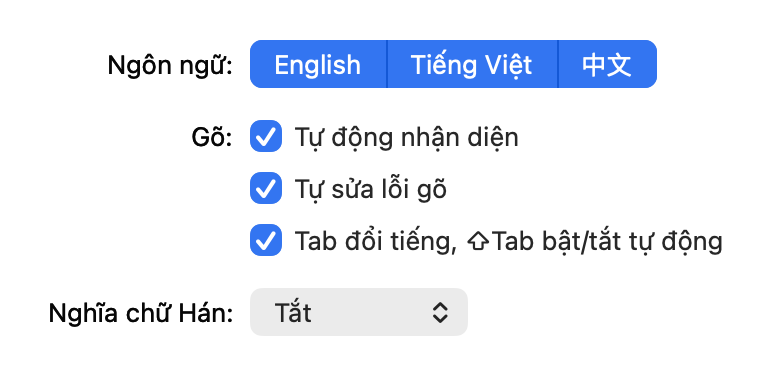

# KeyIn

**A local-first macOS keyboard for English, Vietnamese Telex, and Simplified Chinese.**

[](docs/media/keyin-promo.mp4)

A 30-second promo for macOS and Windows (Vietnamese captions); click it for the
full-resolution video with sound. Auto mode picks the language for each word,
and where it guesses wrong the video fixes it with Tab, as you would. Every
keystroke, candidate and meaning comes from the real engine; `promo/` renders it
(see `promo/CLAUDE.md`).

**Status:** experimental 0.4 preview · **License:** LGPL-3.0-or-later

## Overview

A native macOS input method with a Rust Telex/detection engine, a stateful librime
Chinese engine, and an Objective-C InputMethodKit adapter. All processing stays
on-device. No network service or telemetry. Chinese candidate selections may be
stored in a local user dictionary when learning is enabled.

This is an experimental source release, not a production-readiness claim. The current
Homebrew-based ARM64 build requires macOS 27 because of its bundled dependencies.
The build derives the minimum OS version from the packaged Mach-O files; older
macOS support requires rebuilding all dependencies for that deployment target.

## How it works

Type normally; KeyIn decides per word whether you are writing English, Vietnamese
(Telex) or Chinese (Pinyin), using the word itself and the language of your last
few words. While a word is being composed it is underlined in the app, and a
small frosted panel appears under it:

- **Candidate row:** numbered suggestions in one line. The highlighted one (blue,
  the first by default) is what Space inserts; `↑` `↓` move the highlight, `1`–`9`
  pick directly, `←` `→` page through more (the `›` arrow means more pages exist).
- **Footer:** the active language (🇺🇸 EN, 🇻🇳 VI, 🇨🇳 简中) in its colour, Auto or
  Manual, and the keys that work right now.

| While typing a word | Does |
| --- | --- |
| Space / Return | Insert the highlighted candidate (or the composed word) |
| 1–9 | Insert that candidate |
| ← → | Previous / next candidate page |
| Tab | Switch this word's language: EN → VI → 中 |
| Shift–Tab | Turn Auto detection off (keeps the current language) or back on |
| ↑ ↓ | Move the highlighted candidate (wraps across pages) |
| Esc | Keep the raw keystrokes |

Tab and Shift–Tab are only taken while a word is being composed; at any other
time they reach the app as usual.

### Settings

Click the KeyIn icon in the menu bar and choose **Settings…** (⌘,) — **Tùy chỉnh…** when macOS is set to Vietnamese. The settings, menus and candidate-window hints follow the system language: Vietnamese on a Vietnamese system, English otherwise.



- **Ngôn ngữ:** turn English, Vietnamese or Chinese on or off. Disabled languages
  are never detected and are skipped by Tab; at least one stays on, and with a
  single language KeyIn simply types in it.
- **Tự động nhận diện:** Auto detection (same as Shift–Tab).
- **Tự sửa lỗi gõ:** conservative English/Vietnamese typo correction.
- **Tab đổi tiếng, ⇧Tab bật/tắt tự động:** turn the Tab shortcuts off to let Tab
  commit the word instead.
- **Nghĩa chữ Hán:** show Vietnamese or English meanings beside Chinese
  candidates.

## Install

Requires Apple Silicon and macOS 27.0 or later.

1. Download `KeyIn-<version>-macos-arm64.pkg` from the
   [latest release](https://github.com/tuoitrevohoc/KeyIn/releases).
   `SHA256SUMS.txt` in the same release lists its checksum
   (`shasum -a 256 KeyIn-*.pkg`).
2. If KeyIn is already installed, switch to ABC and quit KeyIn in Activity
   Monitor. If an older copy exists in `~/Library/Input Methods`, move it to a
   backup folder first.
3. Open the package and follow the installer. It installs
   `/Library/Input Methods/KeyIn.app` for all users.
4. Log out of macOS and log back in.
5. Open **System Settings > Keyboard > Text Input > Edit > +**, find KeyIn under
   Vietnamese, add it, and select KeyIn in the input menu.
6. Optional: choose **Settings…** (**Tùy chỉnh…**) in the KeyIn menu to pick languages and
   options (see [Settings](#settings)).

To uninstall, switch to ABC, quit KeyIn, remove it from Keyboard settings, and
delete `/Library/Input Methods/KeyIn.app`. Typing history and preferences are
not removed.

## Build and verification

Requires Rust/Cargo, Xcode Command Line Tools, Homebrew, and `brew install librime`.

```sh
cargo test
cargo clippy --all-targets -- -D warnings
./scripts/build.sh
./scripts/test-native.sh
./scripts/install.sh
```

The build precompiles Rime schemas and dictionary data, copies librime and its
non-system dependency graph into `Contents/Frameworks`, rewrites load paths, and
signs nested libraries and the app ad hoc. Runtime does not require Homebrew.
Dependency licenses and exact Homebrew receipts are bundled in `Resources/ThirdParty`.
Installation registers `~/Library/Input Methods/KeyIn.app`. The install script
still refuses to overwrite an existing app; back up the old app and switch to ABC
before replacing it. Select KeyIn from the input menu afterward.

`./scripts/package.sh` turns `build/KeyIn.app` into an all-users installer at
`build/installer/<version>/`. Set `KEYIN_APP_IDENTITY` (Developer ID Application)
and `KEYIN_INSTALLER_IDENTITY` (Developer ID Installer) to sign it, and
`KEYIN_NOTARY_PROFILE` (a `notarytool store-credentials` profile) to notarize
and staple it. Without them the package is unsigned.

The `macOS installer` workflow does this on every `v*` tag and attaches the signed
package to the tag's release. Run it manually with a tag to re-sign a release that
already exists. It reads these Actions secrets: `CERTIFICATE_P12` (base64 `.p12`
holding both Developer ID identities), `CERTIFICATE_PASSWORD`, `NOTARY_KEY` (an App
Store Connect `.p8` file), `NOTARY_KEY_ID` and `NOTARY_ISSUER_ID`.

### Windows (experimental)

A Text Services Framework port built from the same Rust engine lives in
[`windows/`](windows/README.md). `./windows/build.ps1` produces an x64 MSI, and the
`Windows` workflow builds it on every push.

## Typing

- **English:** words compose inline. Common words are protected from Telex.
- **Vietnamese:** Telex `aa â`, `aw ă`, `ee ê`, `oo ô`, `ow ơ`, `uw ư`, `w ư`,
  `dd đ`, tones `s f r x j`, and `z` removes a tone. `nhwng` → `nhưng`,
  `tieengs` → `tiếng`. Repeated shortcut `ww` escapes to `w`.
- **Chinese:** Rime Simplified Pinyin, with sentence composition, completion,
  initial abbreviations in manual Chinese mode or after Chinese input in Auto, and optional local learning.
  `kankan` → `看看`, `zenmeyang` → `怎么样`, `nihaolema` → `你好了吗`,
  `woganjuehenhaole` → `我感觉很好了`. Rime renders syllable separators itself.
  Typed apostrophes can explicitly disambiguate `xi'an` from `xian`.
- **Space / Return / 1–9:** select a candidate. Selecting a shorter segment keeps
  the remaining phrase in composition, so it can be selected separately.
- **Left / Right:** candidate pages, showing up to 90 candidates in groups of 9.
  **Shift–Left / Shift–Right, Home / End:** move within Rime composition.
  Rime navigates syllable/segment boundaries; Backspace edits at that position.
- **Escape:** retain the raw Pinyin/Telex keystrokes. Focus changes and app
  shortcuts also preserve unselected Pinyin.

**Tab** switches the word being typed to the next enabled language (English →
Vietnamese → Chinese). In manual mode the new language stays for the following
words. **Shift–Tab** toggles Auto: turning it off pins the language currently
shown; turning it on resumes per-word detection. Neither key is taken when no
word is being composed. Both can be disabled in **Settings…**, in which case Tab
commits the word and moves on as in earlier versions. (The Command–Space hotkey of
0.3 has been removed; it conflicted with Spotlight.)

## Auto detection with session context

Auto is enabled initially. The controller remembers only the language IDs of the
last three explicitly committed words/phrases, using the latest confirmed language as the priority for ambiguous input. It also keeps a Chinese composition stable while its Pinyin is being
entered. Context is per input client and reset on deactivation and manual mode
changes; no surrounding document text is read or saved for this heuristic.

Dictionary-verified accented Telex and clear English words take priority. Short
Pinyin readings of up to three letters (including `ne`, `me`, `he`, and `a`)
prefer Chinese immediately after a Chinese commit, even when also English words.
After Chinese input, short/ambiguous Pinyin such as `ni`, `hao`, or `chao` can
remain Chinese; after Vietnamese input, `chao` remains Vietnamese. Clear inputs
such as `hello`, `nhwng`, and `zenmeyang` can switch languages without a hotkey.
Identical Latin spellings remain ambiguous. This is a bounded heuristic, not an
LLM or a general language classifier; use manual mode for long Chinese passages,
names or difficult mixed-language cases.

Vietnamese validation uses 7,067 dictionary components and accepts both `hòa`
and `hoà` tone placement. Unknown or incomplete syllables can remain raw. Manual
Vietnamese bypasses dictionary validation. If Rime data/session initialization
fails, the older Rust Chinese path remains available.

## Learning, correction, and status

Local learning of Chinese candidate choices is on. It uses
`~/Library/Application Support/KeyIn/Rime/pinyin_simp.userdb`. To turn it off,
run `defaults write org.keyin.inputmethod.KeyIn LearnChinese -bool NO` and
reselect KeyIn; KeyIn then uses a schema without user-dictionary learning or
lookup, and previously learned data remains on disk. To reset learning, switch away from KeyIn, quit its
process, back up and remove that directory, and activate KeyIn again.

**Tự sửa lỗi gõ** in settings controls the conservative English/Vietnamese
corrector. It previews repairs such as `teh` → `the`, `tienegs` → `tiếng`, and
`nhwgn` → `nhưng`; Space/Return accepts and Escape retains the original.
Rime handles its own Chinese composition/completion; arbitrary typo repair,
fuzzy-Pinyin rules, and sentence grammar rewriting are not yet implemented.

The panel (see [How it works](#how-it-works)) follows the system light/dark
appearance. Its footer always shows the active language and Auto/Manual; it
remains between words, hides when KeyIn is inactive, and moves above the caret
near the screen's bottom edge.

## Validation and remaining release work

`cargo test` covers Telex, detection and context transitions, dictionary fallback,
correction, Unicode and the C ABI. `scripts/test-native.sh` links against the
**bundled** libraries and tests Rime sentence candidates, selection/partial
selection, cursor editing, session isolation, learning schemas, reopening the
user database in another process, and controller event handling with a fake
text client. It also verifies signatures and absence of Homebrew load paths.
The fake-client harness bypasses InputMethodKit's private client-proxy
constructor and suppresses the panel; it is not a real-app UI compatibility test.
Warm Rime timings printed by this harness exclude OS event dispatch and rendering.

Remaining production-readiness work: exercise TextEdit, Safari, Terminal, Electron editors,
secure fields, focus changes, selection replacement, multiple displays and
accessibility; profile cold startup and long-running memory; improve Auto and
fuzzy Pinyin; support deployment-target builds and universal binaries; add signed
updates with rollback and Developer ID notarization. The app is currently ad hoc
signed for this Mac. There is no claim of complete sentence understanding.

## Source layout

- `native/KeyInRime.m`: Rime lifecycle, isolated sessions, candidates and selection.
- `native/main.m`: InputMethodKit event routing, context, marked text and panel.
- `src/lib.rs`: Telex, context-aware detection, conservative correction and fallback.
- `src/controller.rs`, `src/rime.rs`, `src/meanings.rs`: platform-neutral key handling,
  librime binding and meaning lookup, used by the Windows port.
- `windows/`: TSF text service, candidate window, settings and MSI packaging.
- `data/rime/`: learning and non-learning schemas; source dictionary stays in `data/`.
- `scripts/bundle-rime.py`: dependency packaging, licenses and minimum OS checks.
- `tests/`: native integration harnesses; `tests/rime_engine.rs` drives the Rust
  controller against a real librime when `KEYIN_RIME_LIB` / `KEYIN_RIME_SHARED` are set.

## Dictionary attribution and license

`data/luna_pinyin.dict.yaml` is the unmodified [Rime Luna Pinyin dictionary](https://github.com/rime/rime-luna-pinyin), fetched November 1, 2026 (dictionary version 2024.02.10). Its attribution header is retained. The upstream LGPL-3.0 license is in `data/LICENSE.rime`; the GPL-3.0 text it incorporates is in `data/COPYING.GPL3`. KeyIn source is LGPL-3.0-or-later. The dictionary is embedded in the Rust static library and app; rebuild scripts and source are provided for modification and relinking.

Vietnamese spelling data is derived from [VNTK dictionary](https://github.com/vntk/dictionary), under its MIT license (`data/LICENSE.vntk`). See `data/README.vietnamese.md` and `scripts/import-vietnamese.py` for the pinned source revision and reproducible extraction.


`data/pinyin_simp.dict.yaml` is the unmodified [Rime Simplified Pinyin dictionary](https://github.com/rime/rime-pinyin-simp/blob/0c6861ef7420ee780270ca6d993d18d4101049d0/pinyin_simp.dict.yaml),
retrieved November 1, 2026, revision `0c6861ef7420ee780270ca6d993d18d4101049d0`.
It includes phrase readings and frequency weights (for example `看看` and `怎么样`).
Its Android Open Source Project attribution remains in the file header; the
upstream Apache-2.0 license is included in `data/LICENSE.pinyin-simp` and bundled
with the app. The source supplies initial weights; the Rime engine additionally supports sentence composition and local user-dictionary learning.


Librime is BSD-3-Clause; its license and the dependency notices are copied from the installed Homebrew formulae into the app during the build.

## Chinese initial abbreviations

Rime supports initial-letter Pinyin such as `nhlm` (`ni hao le ma`). Auto routes
lowercase initial-only strings of 2–8 letters to Rime only when the preceding
context is Chinese. Clear English words and valid transformed Telex still win;
`nhwng` remains `nhưng`. Without Chinese context, use manual Chinese mode to
start abbreviations. This avoids globally treating English abbreviations as Pinyin,
but cannot eliminate ambiguity inside Chinese context; manual English is available.

`data/rime/keyin-phrases.tsv` adds a KeyIn-authored conversational seed for
`你好了吗` to the **build copy** of the Rime dictionary, so `nhlm` offers it without
requiring prior personal learning. The upstream dictionary file remains unchanged.
Other initial strings may have many readings; select the intended candidate and
Rime can learn that choice when local learning is enabled.

`data/rime/keyin-words.tsv` adds about 146,000 frequent words that
`pinyin_simp` lacks (for example `越南语`, `越南人`, `韩国语`) to the same build copy
and to the built-in table used on iOS. Without them a reading like `yuenanyu` had no
whole-word entry, so it was assembled from unrelated high-frequency pieces
(`月难于`). Words and frequencies come from [jieba](https://github.com/fxsjy/jieba),
readings from [phrase-pinyin-data](https://github.com/mozillazg/phrase-pinyin-data),
both MIT (`data/LICENSE.chinese-words`). See `data/README.chinese-words.md` and
`scripts/import-chinese-words.py` to regenerate it.

## Choosing an ambiguous word's language

While a word is being composed, **Tab** cycles its language (EN → VI → 中, skipping
disabled languages) and **Shift+Tab** toggles Auto. English/literal input is always
an escape choice; for example, `chao` can be committed as English, Vietnamese or
Chinese. Switching keeps the original keystrokes and restarts candidate selection
for that language. In Auto the choice holds for this word only; Space/Return commits
it and updates language context. **Up / Down** move the highlighted candidate; with
no candidates they commit the word and pass through to the application.

### Chinese word meanings

In **Settings…**, set **Chinese meanings** (**Nghĩa chữ Hán**) to **Tiếng Việt** or **English** to show a
gloss beside each Chinese candidate while typing; candidates then list
vertically. Choose **Tắt** to restore the single candidate row (the default). The selection is saved; number keys and Space still insert only
Chinese text.

Lookup is offline using `data/chinese-meanings.json`: 125,353 distinct simplified
headwords, with 119,046 Vietnamese glosses and 121,593 English glosses. Sources
are CVDICT (Phong Phan) and CC-CEDICT (MDBG and contributors), with curated KeyIn
overrides. The dictionary data is distributed under CC BY-SA 4.0; see
[data sources and limitations](data/README.chinese-meanings.md).

CVDICT is largely AI-translated with partial manual review and can contain errors.
Unknown words have no placeholder. When a phrase has no exact dictionary entry,
KeyIn displays separate glosses for its words (longest match first), falling back
to individual characters. Unknown segments are skipped. These labeled glosses
are reading aids, not a translation of the whole sentence. Candidate rows wrap
to three lines; full text remains available to accessibility tools.

In Auto mode, a valid Vietnamese reading takes precedence over an ambiguous
English word when the current typing context is Vietnamese (`its` → `ít`).
Unambiguous English input can still switch languages. Chinese glosses use a
smaller, light italic font and show the first sense (up to 72 characters) for
compact reading; sentence annotations retain separate word labels.
